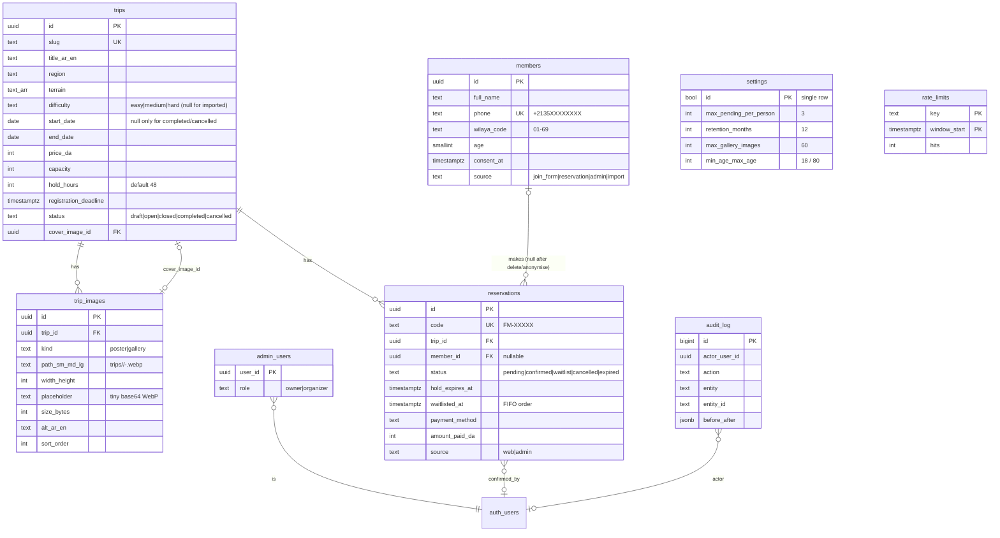

# Data model (Supabase / Postgres)

Source of truth: the SQL migrations in [`supabase/migrations/`](../supabase/migrations/). Generated
TypeScript types: `src/lib/database.types.ts` (`npm run db:types`). Never change the production schema by
hand; add a migration.

## Changes from the brief's schema, and why

| Change | Reason |
|---|---|
| `reservations.member_id` nullable, `ON DELETE SET NULL` | Deleting a member (privacy request) or the retention job removes the link to the person but keeps trip history, counts and amounts. (The plan mentioned a `name_snapshot`; it was dropped because keeping a name after deletion would defeat the purpose.) |
| `trips.start_date`, `end_date`, `difficulty`, `price_da`, `capacity` nullable, but required for `open`/`closed` (CHECK `trips_bookable_complete`) | The 14 imported v1 trips have no known dates/difficulty. Anything bookable must be complete. |
| `reservations.waitlisted_at` | FIFO waitlist order; "move to waitlist" puts someone at the back. |
| `reservations.source` (`web`/`admin`), `hold_extended_at`, `anonymised_at` | Distinguish DM bookings, show hold extensions, mark retention anonymisation. |
| `trip_images.placeholder` (tiny base64 WebP) instead of blurhash | No decoding library on the public site; it's a CSS background. |
| `trip_images.size_bytes` | Storage meter on the admin Overview. |
| `settings` (single row) | Hold hours default, pending limit, retention, gallery limit, age range: editable by the owner, no deploy. |
| `rate_limits` + `hit_rate_limit()` | Strict, global per-phone / per-code limits (Cloudflare's binding is per-location and approximate). |
| Text + CHECK instead of Postgres enums | Easier to evolve with migrations; types are still generated as string unions. |
| Schema `private` for internal helpers | Not exposed through the Data API; only reachable from `SECURITY DEFINER` functions. |

## Seat logic

`reserve_seat()` (server only) locks the trip row (`FOR UPDATE`), checks status/deadline/date, upserts the
member by phone, returns the existing active reservation instead of creating a duplicate, enforces the
pending-hold limit, then inserts `pending` (with `hold_expires_at = now() + hold_hours`) if
`capacity − (confirmed + unexpired pending) > 0`, otherwise `waitlist`. Because expired holds are excluded by
time, counts are right **even if `expire_holds()` never runs**. The partial unique index
`reservations_one_active_idx (trip_id, member_id) WHERE status IN ('pending','confirmed','waitlist')` is a
second safety net.

Admin actions (`admin_confirm`, `admin_cancel`, `admin_promote`, `admin_move_to_waitlist`,
`admin_extend_hold`, `admin_add_manual_reservation`) re-check capacity under the same lock. Confirming over
capacity needs `p_override_capacity = true` **and** the owner role, and writes a `confirm_over_capacity` audit
entry. Status columns can't be updated directly (column-level grants); only these functions change them.

## Security model (summary, details in `docs/SECURITY.md`)

- RLS enabled on every table; table grants start from nothing.
- `anon` / non-admin users: `SELECT` on `trips` with status `open`/`closed`/`completed` and their
  `trip_images`, plus `trip_public_stats()` (capacity and seats left only). Nothing else.
- Admin = row in `admin_users` **and** an MFA-verified session (`aal2`), checked in `is_admin()` itself, so
  it also holds for direct API calls. `is_owner()` for owner-only actions (delete members/trips, manage
  admins, read the audit log, change settings).
- Public writes only through `reserve_seat`, `join_member`, `reservation_status`, `hit_rate_limit`, which
  are executable by `service_role` only (the server, after validation + Turnstile).
- Every `SECURITY DEFINER` function pins `search_path = ''`; `EXECUTE` is revoked from `public`, `anon`,
  `authenticated` and granted per function.
- Audit: triggers log every insert/update/delete made by a signed-in user, with before/after JSON. Excel exports
  call `log_export(entity, entity_id, rows, filter)` before any row leaves the server; the entry (`action =
  'export'`) records who, which list (`reservations` with the trip id, or `members`), the filters used and the
  row count. See `docs/EXPORTS.md`.
- Storage bucket `trip-images`: public read by URL, 15 MB, `image/webp` only, write/delete for `is_admin()` only.

## Jobs

| Function | Schedule | Effect |
|---|---|---|
| `expire_holds()` | every 15 min | `pending` with past `hold_expires_at` → `expired` |
| `anonymise_old_reservations()` | daily | Reservations of trips that ended more than `retention_months` ago: unlink member, clear notes; also prunes old `rate_limits` rows |
| `keep_alive()` | daily | Activity so the free project doesn't pause |

## Tests

`npm run test:db` (local stack only, a guard refuses other hosts): concurrency (30 parallel bookings on 5
seats), duplicate phone, expiry, over-capacity override, FIFO promotion, manual bookings, retention, member
deletion, and the full RLS/storage matrix for anon, signed-in user, admin without MFA, organizer and owner.
